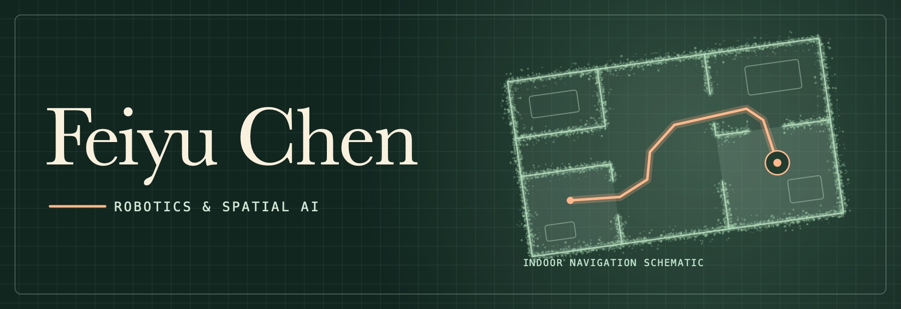

**Hi, I’m Ferry.** I’m a robotics master’s student and research assistant at the University of Minnesota. A question that ties my work together is what a robot should remember about a place so it can make a better decision on its next visit.

[Research ↓](#research) · [Selected work ↓](#selected-work)

## Research

**Robots that help build urban digital twins**  
At the Minnesota Robotics Institute, I connect language-model agents to ROS 2 so a mobile robot can report what it sees and where it is. I’m interested in using those observations to choose where to scan next and judge what a new scan adds to a map.

## Selected work

### [Opv2 · A study companion for operating systems](https://github.com/RemainMemory/Opv2)

A student can ask a question about an operating systems concept and trace the answer to the course material. I built the hybrid search pipeline and the interface that presents the answer and its evidence.

### [Classroom Translator · Live bilingual captions](https://github.com/Kuko1414/classroom-translator)

An English-to-Chinese lecture captioning pipeline that runs on Apple Silicon. I worked on streaming captions so readers get a first translation while the lecturer is still speaking.

### [Human-tracking · Person detection](https://github.com/RemainMemory/Human-tracking)

An earlier computer vision project that uses TensorFlow and OpenCV to detect people in photos, recorded video, and a live camera feed.

Education, experience, and publication

- **University of Minnesota Twin Cities** · M.S. student in Robotics and Graduate Research Assistant at the Minnesota Robotics Institute.
- **Kunming University of Science and Technology** · B.Eng. in Artificial Intelligence, 2025.
- **Industry** · Built agent tools and document validation during a full-stack AI internship at Beijing Shuimu Molecular Biotechnology. Built a local retrieval pipeline during an algorithm internship at East China Architectural Design & Research Institute.
- **Publication** · “Neural Network-Based Prediction and Analysis of Netflix Subscription Duration.” International Conference on Data Analysis and Machine Learning, 2023.

[Earlier algorithm practice plan · 算法刷题学习计划](https://github.com/RemainMemory/RemainMemory/blob/d85e64eb09059e23b4ced939c1077b1298eb2114/README.md)

